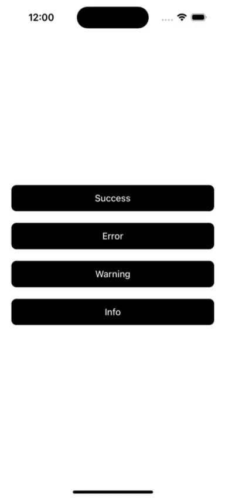

# React Native Calendars Strip

[](https://www.npmjs.com/package/react-native-calendars-strip)
[](./LICENSE)
[](./index.d.ts)

A horizontal calendar strip and day picker for React Native and Expo. Drop it into booking, attendance, habit or scheduling screens, and users can pick a day without opening a full calendar.



## Quick start

```bash
npm install react-native-calendars-strip
```

```tsx
import Calendar from 'react-native-calendars-strip';

<Calendar onDateSelect={(date) => console.log(date.format('YYYY-MM-DD'))} />;
```

That's all you need. It's pure JavaScript, so there are no native modules, no `pod install` and no Expo config plugin.

## Features

- **Selected day stays in view:** the strip scrolls to it on open, on tap and on month change
- **Month navigation:** previous and next arrows, with an `onMonthChange` callback
- **Date limits:** `minDate` and `maxDate` disable days and stop the arrows at the edge of the range
- **Controlled or uncontrolled:** pass `selectedDate`, or let the component manage it
- **Fully themeable:** colours, text, containers and arrows, including dark mode
- **Responsive:** follows rotation and split-screen
- **Accessible:** screen reader labels and states on every day and arrow
- **TypeScript types included**

## Examples

### Booking screen: only allow the next 30 days

```tsx
import React, { useState } from 'react';
import moment from 'moment';
import Calendar from 'react-native-calendars-strip';

const BookingDatePicker = () => {
  const [date, setDate] = useState(moment());

  return (
    <Calendar
      selectedDate={date}
      minDate={moment()}
      maxDate={moment().add(30, 'days')}
      onDateSelect={setDate}
    />
  );
};
```

### Dark theme

```tsx
<Calendar
  calendarStyle={{
    containerStyle: { backgroundColor: '#111827' },
    headerTextStyle: { color: '#F9FAFB' },
    arrowColor: '#F9FAFB',
    dayContainerStyle: { backgroundColor: '#1F2937' },
    dayTextStyle: { color: '#D1D5DB' },
    dateTextStyle: { color: '#F9FAFB' },
    selectedDayColor: '#6366F1',
  }}
/>
```

### Load data when the month changes

```tsx
<Calendar
  onMonthChange={(month) => loadEvents(month.format('YYYY-MM'))}
  onDateSelect={(date) => setDay(date.format('YYYY-MM-DD'))}
/>
```

## Props

All props are optional. Dates can be anything `moment()` accepts, such as a `Date`, a moment object or an ISO string like `'2026-11-06'`.

| Prop | Type | Default | Description |
| --- | --- | --- | --- |
| `selectedDate` | date | today | The date to show as selected. The calendar follows this prop whenever it changes. |
| `minDate` | date | none | Days before this date are disabled. |
| `maxDate` | date | none | Days after this date are disabled. |
| `onDateSelect` | `(date: Moment) => void` | none | Called when a day is tapped. Also called when the month arrows select a new date, which is the 1st of the month, or `minDate` if that is later. |
| `onMonthChange` | `(date: Moment) => void` | none | Called when the month arrows change the month. |
| `firstTime` | `boolean` | `false` | Draws the selected day like any other day, unless `selectedDayColor` is set. Turn it off to show the selection. |
| `calendarStyle` | object | `{}` | Style options, listed below. |

## Styling with `calendarStyle`

| Key | Type | Description |
| --- | --- | --- |
| `selectedDayColor` | `string` | Background of the selected day |
| `selectedDayTextColor` | `string` | Text colour of the selected day |
| `arrowColor` | `string` | Colour of the month arrows |
| `containerStyle` | `ViewStyle` | Outer container |
| `headerTextStyle` | `TextStyle` | Month and year title |
| `dayContainerStyle` | `ViewStyle` | Each day cell. Use `backgroundColor` to set the colour of unselected days. |
| `dayTextStyle` | `TextStyle` | Day name, such as "Mon" |
| `dateTextStyle` | `TextStyle` | Day number |

## Switching from react-native-calendar-strip

Most props map directly, and both packages use `moment` dates.

| `react-native-calendar-strip` | This package |
| --- | --- |
| `selectedDate` | `selectedDate` |
| `onDateSelected` | `onDateSelect` |
| `onWeekChanged` | `onMonthChange` |
| `minDate`, `maxDate` | `minDate`, `maxDate` |
| `style` | `calendarStyle.containerStyle` |
| `calendarHeaderStyle` | `calendarStyle.headerTextStyle` |
| `dateNameStyle` | `calendarStyle.dayTextStyle` |
| `dateNumberStyle` | `calendarStyle.dateTextStyle` |

There are some differences to check first. This package shows one month at a time rather than one week, `minDate` and `maxDate` disable individual days, and `markedDates` and custom arrow icons aren't supported yet.

## Contributing

Bug reports and feature requests are welcome in [GitHub issues](https://github.com/adityarajput751/react-native-calendars-strip/issues). If this package saves you time, a ⭐ on GitHub helps other developers find it.

## License

[ISC](./LICENSE)
